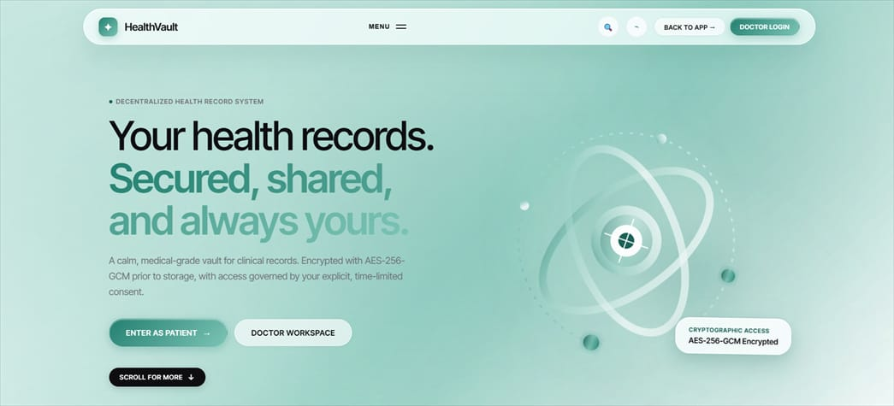
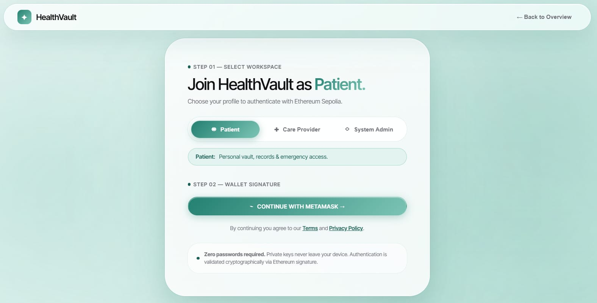
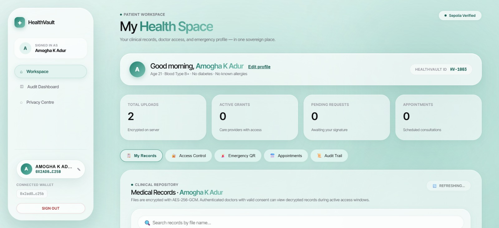
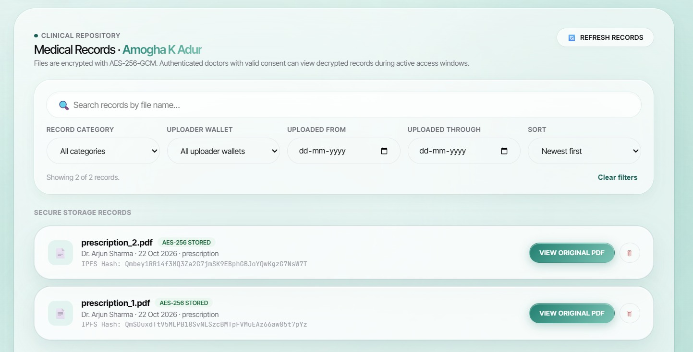
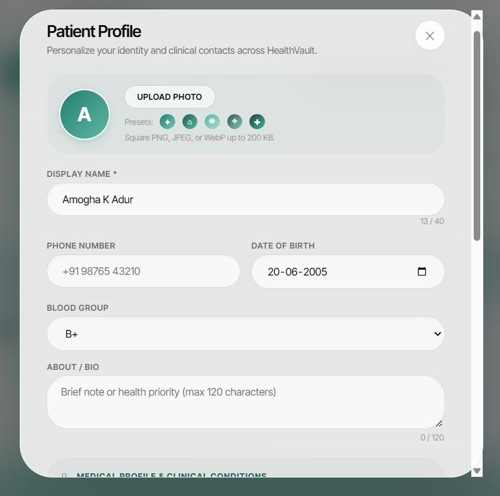

# 🏥 HEALTHVAULT
### THE FUTURE OF HEALTHCARE. SECURED BY BLOCKCHAIN.

  <strong>YOUR HEALTH. YOUR DATA. YOUR CONTROL.</strong>

  A blockchain-powered Electronic Health Record platform designed to make healthcare data secure, transparent, and patient-controlled.

  
  

  
  
  
  
  

---

## ◈ 01 — THE VISION

Healthcare data is among the most sensitive information a person owns. Yet traditional Electronic Health Record systems face challenges involving centralized storage, fragmented medical records, unauthorized access, and limited patient control.

**What if patients could actually own and control their medical records?**

Introducing **HealthVault** — a blockchain-based approach to Electronic Health Record management that combines encryption, decentralized storage, and smart contract technology to support a more secure healthcare ecosystem.

---

## ◈ 02 — THE EXPERIENCE

### ✦ Landing Page

  

### ✦ Patient and Doctor Login

  

### ✦ Patient Dashboard

  

### ✦ Medical Records

  

### ✦ Patient Profile

  

---

## ◈ 03 — CORE CAPABILITIES

| Capability | Description |
|---|---|
| 🔐 AES-256 Encryption | Encrypts sensitive medical documents before storage |
| 🌐 IPFS Storage | Uses decentralized storage for encrypted medical files |
| ⛓️ Blockchain Integration | Records important access and consent operations |
| 🛡️ Patient-Controlled Access | Patients decide who can access their records |
| ⏳ Time-Limited Consent | Supports time-bound access permissions |
| 🔄 Revocable Permissions | Allows patients to revoke previously granted permissions |
| 👨‍⚕️ Role-Based Access | Supports patient, doctor, and administrator roles |
| 🦊 MetaMask Integration | Enables wallet-based blockchain interactions |

---

## ◈ 04 — SYSTEM ARCHITECTURE

HealthVault follows a layered architecture connecting the frontend, backend, encryption services, decentralized storage, and blockchain.

  

⬇️

  

⬇️

  

⬇️

  

⬇️

  

**Blockchain Interaction:** Ethers.js connects the backend and frontend with Solidity smart contracts, while MetaMask enables wallet-based transactions.

### Technology Stack

| Layer | Technologies |
|---|---|
| Frontend | React.js, Vite |
| Backend | Node.js, Express.js |
| Smart Contracts | Solidity, Hardhat |
| Blockchain | Ethereum Sepolia Testnet |
| Blockchain Interaction | Ethers.js |
| Wallet | MetaMask |
| Decentralized Storage | IPFS, Pinata |
| Encryption | AES-256 |
| API Communication | Axios |

## ◈ 05 — HOW IT WORKS

**01 / UPLOAD**

Patients upload their medical documents through the application.

**02 / ENCRYPT**

The backend encrypts medical documents using AES-256 before storage.

**03 / DECENTRALIZE**

Encrypted files are uploaded to IPFS through Pinata.

**04 / VERIFY**

Relevant record references and access-related operations are associated with blockchain transactions.

**05 / AUTHORIZE**

Patients grant doctors permission to access their medical records through smart contract-based consent management.

**06 / CONTROL**

Patients can monitor permissions and revoke access whenever necessary.

---

## ◈ 06 — SECURITY BY DESIGN

Security is a fundamental part of HealthVault's architecture.

- **Data Confidentiality:** Medical documents are encrypted before decentralized storage.
- **Patient Authorization:** Access permissions are managed through smart contracts.
- **Consent Management:** Patients control who can access their records.
- **Blockchain Verification:** Transactions provide verifiable evidence of recorded operations.
- **Wallet-Based Authentication:** MetaMask supports wallet-based authentication and blockchain interactions.
- **Decentralized Storage:** Encrypted files are stored separately from the blockchain.

> Medical documents are not stored directly on the blockchain. Encrypted files are stored through IPFS, while the blockchain is used for relevant record references and access-related operations.

---

## ◈ 07 — SOCIAL IMPACT

HealthVault explores how decentralized technologies can improve healthcare data management.

- Greater patient ownership of medical information.
- More secure medical record sharing.
- Improved transparency in healthcare data access.
- Reduced dependence on centralized record storage.
- Better coordination between healthcare professionals.

**Our belief:** Healthcare data should remain under the control of the people it belongs to.

---

## ◈ 08 — THE ROAD AHEAD

Potential future enhancements include:

- 🧠 AI-powered medical record analysis.
- 🪪 Decentralized Identity (DID) integration.
- 🏥 Hospital and healthcare provider integration.
- 🔗 Improved interoperability between healthcare systems.
- 🚑 Enhanced emergency medical record access.

---

## ◈ 09 — EXPERIENCE HEALTHVAULT

  

  <i>Explore secure medical record management and patient-controlled access.</i>

---

## ◈ 10 — BUILT BY

  <strong>AMOGHA K ADUR</strong>
   
  Information Science & Engineering
    
  <a href="https://github.com/Amoghadur">GitHub</a>
  &nbsp; • &nbsp;
  <a href="https://www.linkedin.com/in/amogha-k-adur/">LinkedIn</a>

---

  <strong>HEALTHVAULT</strong>
   
  <i>Privacy isn't a feature. It's the foundation.</i>
    
  Built with ❤️ and a vision for better digital healthcare.

